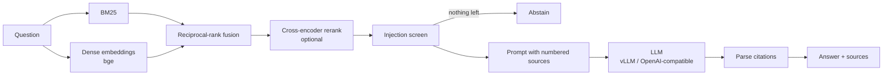

# production-rag-service: retrieval-augmented answers with citations, measured

[](https://github.com/kishorhange111/production-rag-service/actions/workflows/ci.yml)


A question-answering API over your own documents. It runs hybrid retrieval (BM25 + dense embeddings, fused with reciprocal-rank fusion) and an optional cross-encoder reranker. Answers cite their sources. It screens retrieved text for prompt injection, abstains when the sources don't contain the answer, and streams responses. An evaluation suite on SQuAD 2.0 measures each of these choices instead of assuming it helps.

**Author:** Kishor Hange

<!-- RESULTS:START -->
## Results

The SQuAD 2.0 evaluation below has not been run yet: the Colab GPU runtime for it was not available, so this repository makes no quality claims. `scripts/colab_job.sh` runs the retrieval ablation (BM25 vs. dense vs. hybrid vs. hybrid + reranker; Recall@k, MRR, nDCG@10) and the answer evaluation (closed-book baseline, abstention on unanswerable questions, judged faithfulness, false-positive rate of the injection screen) on one GPU.

What is verified today is the service itself: the CPU test suite covers chunking, ranking, fusion, the injection screen, citation parsing, the metric formulas and the HTTP API, and CI builds the Docker image and checks its health endpoint.
<!-- RESULTS:END -->

## Architecture



| Stage | Choice | Why |
|---|---|---|
| Chunking | Heading-aware, ~200 words with overlap, heading kept with each chunk | A chunk stays readable on its own and carries its section title |
| Retrieval | BM25 + dense, fused by rank (RRF, k = 60) | BM25 catches exact names and codes, embeddings catch paraphrases; RRF needs no score calibration |
| Reranking | `BAAI/bge-reranker-base`, off by default | It costs a forward pass per candidate, so it stays off until the evaluation shows it helps |
| Prompt injection | High-precision patterns ("ignore previous instructions", fake system turns) drop a chunk before it reaches the LLM | Retrieved documents are untrusted input |
| Abstention | No usable sources → fixed "I don't know" without calling the LLM; the model is also told to abstain | An answer without evidence is a hallucination |
| Citations | Sources are numbered `[1] … [k]`; cited numbers are parsed and returned | Every claim can be checked by the reader |

## API

| Method | Path | Purpose |
|---|---|---|
| GET | `/health` | Liveness, plus the number of indexed chunks |
| POST | `/ingest` | Add documents (`doc_id`, `text`, `metadata`); idempotent by chunk content |
| POST | `/query` | Answer with sources, cited source numbers and per-stage timings |
| POST | `/query/stream` | Server-sent events: `sources` first, then `token` events, then `done` |
| GET | `/metrics` | Prometheus text format: request counter by path and status, latency histogram |

Every response carries an `X-Request-ID` (echoed from the client when sent). If `RAG_API_KEY` is set, every call except `/health` needs an `X-API-Key` header, compared in constant time.

## Quickstart

```bash
pip install -e .                       # lightweight: hashing embedder + extractive answers, no GPU
RAG_DATA_DIR=data/sample uvicorn ragservice.api:app --port 8080

curl -s localhost:8080/query -H 'content-type: application/json' \
     -d '{"question": "How long are database backups kept?"}'
```

With real models on a GPU machine, `docker compose up` starts vLLM serving Qwen2.5-7B-Instruct next to the API. Configuration is by environment variable:

| Variable | Default | Meaning |
|---|---|---|
| `RAG_EMBEDDER` | `hashing` | A sentence-transformers model name, e.g. `BAAI/bge-small-en-v1.5` |
| `RAG_LLM_URL` | unset | OpenAI-compatible base URL; unset uses the extractive fallback |
| `RAG_LLM_MODEL` | `Qwen/Qwen2.5-7B-Instruct` | Model name on that server |
| `RAG_MODE` | `hybrid` | `bm25`, `dense` or `hybrid` |
| `RAG_TOP_K` | `5` | Sources per answer |
| `RAG_DATA_DIR` | unset | Folder of `.md` / `.txt` files to ingest at start-up |
| `RAG_API_KEY` | unset | Require this key on every call except `/health` |

## Evaluation

```bash
pip install -e ".[ml]"
python -m ragservice.eval.runner retrieval --n 300 --out results/retrieval.json
python -m ragservice.eval.runner answers --n 300 --generator Qwen/Qwen2.5-7B-Instruct \
       --judge Qwen/Qwen2.5-7B-Instruct --out results/answers.json
```

The benchmark is SQuAD 2.0: 300 answerable and 300 unanswerable questions, retrieving from every Wikipedia passage in the validation set (about 1,200), so the right passage has to be found among many distractors. Unanswerable questions are the point. A RAG system should say "I don't know" to them, and a closed-book model, given the same questions without sources, shows how much retrieval adds. All metrics come with bootstrap 95 % confidence intervals. The evaluation uses the same abstain rule as the served pipeline, so it measures the system that is deployed. `scripts/colab_job.sh` runs both steps on a Colab GPU.

## Project layout

```
production-rag-service/
├── src/ragservice/             # the service (installable package)
│   ├── chunking.py             #   heading-aware chunks with overlap
│   ├── embeddings.py           #   sentence-transformers (with BGE query prefix) and a hashing fallback
│   ├── index.py                #   BM25 and dense indexes, save / load
│   ├── retrieval.py            #   RRF fusion, cross-encoder reranker
│   ├── guardrails.py           #   injection screen, abstention rule
│   ├── generation.py           #   prompt, citation parsing, LLM clients
│   ├── pipeline.py             #   retrieve → screen → generate
│   ├── api.py                  #   FastAPI app
│   └── eval/                   #   SQuAD 2.0 loader, retrieval and answer metrics, runner
├── data/sample/                # small document set the API and Docker smoke test serve
├── scripts/                    # Colab evaluation job
├── tests/                      # CPU-only tests, including the HTTP API
├── Dockerfile                  # production image (uvicorn, health check)
├── docker-compose.yml          # API + vLLM serving Qwen2.5-7B-Instruct
├── .github/workflows/ci.yml    # lint + tests, then build the image and smoke-test the API
├── Makefile                    # make install / install-dev / lint / test / serve / docker
└── pyproject.toml              # package metadata, dependencies, ruff + pytest config
```

## Tests

`pytest` runs on CPU with no model downloads. It covers chunk sizes and overlap, BM25 and dense ranking, fusion, the injection screen, citation parsing, the evaluation metrics, and the HTTP API: validation errors, the API key, request IDs, streaming order and the Prometheus output. CI also builds the Docker image and calls its health check.

`make check` runs the same lint and test steps as CI, and `make help` lists the other commands. Optionally, `pip install pre-commit && pre-commit install` runs ruff before every commit.

## Limitations

- The index lives in process memory, so the container runs one worker; scale out with replicas that load the same saved index. Documents sent to `/ingest` reach only the replica that served the call. A shared vector store (pgvector, Qdrant) is the next step if ingestion has to be live.
- The injection screen is pattern-based. It catches common attacks with few false alarms (the false-positive rate is measured on SQuAD passages) but not paraphrased or encoded ones.
- SQuAD passages are short and clean; long, messy enterprise documents would stress chunking more.

## License

MIT
