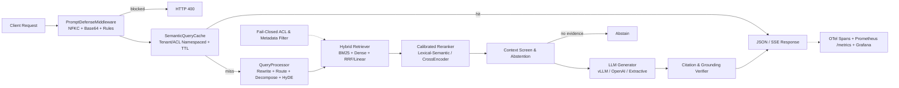

# production-rag-service

[](https://github.com/kishorhange111/production-rag-service/actions/workflows/ci.yml)
[](https://github.com/kishorhange111/production-rag-service/actions/workflows/eval-gate.yml)


An enterprise-ready Retrieval-Augmented Generation (RAG) service built with FastAPI. Features multi-format table-aware ingestion, incremental CDC re-indexing, hybrid BM25 + dense retrieval with weighted RRF / linear fusion, calibrated reranking, fail-closed multi-tenant ACLs, query rewriting/HyDE/routing, deterministic citation & faithfulness verification, tenant-isolated semantic caching, layered prompt-injection defense, OpenTelemetry + Prometheus/Grafana observability, automated CI eval regression gates, and Docker Compose / Kubernetes / Helm deployment manifests.

**Author:** Kishor Hange

---

## Architecture



### Key Production Capabilities

| Area | Implementation | Module |
|---|---|---|
| Multi-format Ingestion | Markdown (heading + pipe-table aware), HTML (script/nav stripping), CSV (header-repeating row batches) | `src/ragservice/ingestion.py` |
| Incremental CDC | SHA-256 content-hash dedup, atomic `upsert_doc` / `remove_doc`, dead-letter capture | `src/ragservice/cdc.py`, `index.py` |
| Hybrid Retrieval | BM25 + dense cosine, weighted RRF & min-max linear fusion, `max_per_doc` diversity, diagnostics | `src/ragservice/retrieval.py` |
| Reranking & Calibration | `Reranker` protocol, CPU `LexicalSemanticReranker`, `CrossEncoderReranker`, sigmoid/min-max calibration | `src/ragservice/reranker.py` |
| Multi-Tenant Security | Fail-closed tenant, role, principal, explicit-deny, clearance & metadata filtering at retrieval time | `src/ragservice/acl.py` |
| Query Intelligence | Filler stripping, acronym expansion, intent routing (`exact_lookup` -> BM25), sub-query RRF, HyDE | `src/ragservice/query.py` |
| Grounding & Citations | Sentence-level claim extraction, strict numeric consistency check, out-of-range citation detection | `src/ragservice/citations.py` |
| Semantic Cache | Cosine-similarity + exact-match cache partitioned by `(tenant, roles, clearance, filters)` with TTL/LRU | `src/ragservice/cache.py` |
| Injection Defense | Query ingress middleware + chunk screening catching zero-width, NFKC, base64, delimiter & exfil attacks | `src/ragservice/security.py` |
| Streaming API | Typed Pydantic v2 schemas, SSE (`sources` -> `token` -> `grounding` -> `done`), `X-Request-ID`, `X-Trace-ID` | `src/ragservice/api.py`, `schemas.py` |
| Observability | OTel-compatible span tracer, Prometheus `/metrics`, Grafana dashboard JSON & Prometheus scrape config | `src/ragservice/observability.py`, `observability/` |
| CI Eval Gate | Automated PR-blocking quality gate over golden QA fixtures (`ragservice-eval-gate`) | `src/ragservice/eval/suite.py`, `gate.py` |

---

## Verified Benchmarks & Evaluation

### 1. Golden QA CI Regression Gate (`python -m ragservice.eval.gate`)

Measured locally on CPU (`data/sample/` corpus, `data/eval/golden_qa.json` 10 cases: 8 answerable + 2 unanswerable, BM25 + `ExtractiveLLM`, `top_k=3`):

| Metric | Observed Score | CI Gate Threshold | Status |
|---|---:|---:|:---:|
| Context Recall@3 | **1.000** | >= 0.850 | PASS |
| MRR | **1.000** | info | PASS |
| Faithfulness | **1.000** | >= 0.850 | PASS |
| Citation Precision | **1.000** | >= 0.850 | PASS |
| Answer Match | **1.000** | >= 0.750 | PASS |
| Abstention Recall | **1.000** | >= 0.900 | PASS |
| False Abstention Rate | **0.000** | <= 0.100 | PASS |
| Avg End-to-End Latency | **0.45 ms** | info | PASS |

### 2. Concurrent Load Benchmark (`python benchmarks/load_test.py`)

Measured locally on CPU (hybrid mode, 4 concurrent worker threads, 200 requests, `HashingEmbedder` + `ExtractiveLLM`):

| Mode | Concurrency | Requests | Throughput (RPS) | Error Rate | p50 (ms) | p95 (ms) | p99 (ms) |
|---|---:|---:|---:|---:|---:|---:|---:|
| in-process | 4 | 200 | **2013.6** | **0.00%** | **0.69** | **7.73** | **12.24** |

For HTTP load testing against a live deployment, run `k6 run benchmarks/k6_load_test.js` or `python benchmarks/load_test.py --url http://localhost:8080/query`.

> **Note on GPU SQuAD 2.0 eval:** `scripts/colab_job.sh` and `python -m ragservice.eval.runner` run the full 600-question SQuAD 2.0 ablation (BGE embeddings + `Qwen2.5-7B-Instruct` + LLM judge with 95% bootstrap CIs) when a GPU is available; no unrun GPU numbers are claimed here.

---

## HTTP API

| Method | Path | Purpose |
|---|---|---|
| `GET` | `/health` | Liveness/readiness + indexed chunk count |
| `POST` | `/ingest` | Ingest Markdown/HTML/CSV/text documents with metadata (idempotent) |
| `POST` | `/query` | Cited answer with optional `tenant_id`, `roles`, `filters`, `verify_grounding` |
| `POST` | `/query/stream` | SSE stream: `sources` -> `token` -> optional `grounding` -> `done` |
| `GET` | `/metrics` | Prometheus metrics (HTTP RPS/latency, stage latency, cache, guardrails, abstentions, chunks) |

Every response carries `X-Request-ID` and `X-Trace-ID`. Setting `RAG_API_KEY` enforces constant-time `X-API-Key` auth on all endpoints except `/health`.

---

## Quickstart & Deployment

### Local (CPU, zero API keys)
```bash
pip install -e ".[dev]"
RAG_DATA_DIR=data/sample uvicorn ragservice.api:app --port 8080

curl -s localhost:8080/query -H 'content-type: application/json' \
     -d '{"question": "How long are database backups kept?", "verify_grounding": true}'
```

### Docker Compose (API + Prometheus + Grafana + optional GPU vLLM)
```bash
# CPU stack + Prometheus (:9090) + Grafana (:3000)
docker compose -f docker-compose.prod.yml up --build

# GPU stack with vLLM serving Qwen2.5-7B-Instruct
docker compose -f docker-compose.prod.yml --profile gpu up --build
```

### Kubernetes & Helm
```bash
# Raw manifests (non-root, read-only rootfs, probes, HPA 2..10, PDB)
kubectl apply -f deploy/k8s/

# Or via Helm chart
helm upgrade --install rag-service deploy/helm/rag-service
```

---

## Architecture Decision Records (ADRs)

- [ADR-001: Hybrid BM25 + Dense Retrieval with Weighted RRF and Linear Fusion](docs/adr/001-hybrid-retrieval-and-fusion.md)
- [ADR-002: Fail-Closed Multi-Tenant ACLs and Isolated Semantic Caching](docs/adr/002-multi-tenant-acl-and-cache-isolation.md)
- [ADR-003: Layered Prompt-Injection Defense and Deterministic Grounding Verification](docs/adr/003-layered-security-and-grounding.md)
- [ADR-004: Deterministic CI Evaluation Regression Gate](docs/adr/004-ci-eval-regression-gate.md)

## Testing & Quality Checks

```bash
ruff check .
ruff format --check .
pytest -v
python -m ragservice.eval.gate
```

All **80 tests** run deterministically on CPU with zero external API keys or model downloads.

## License

MIT
